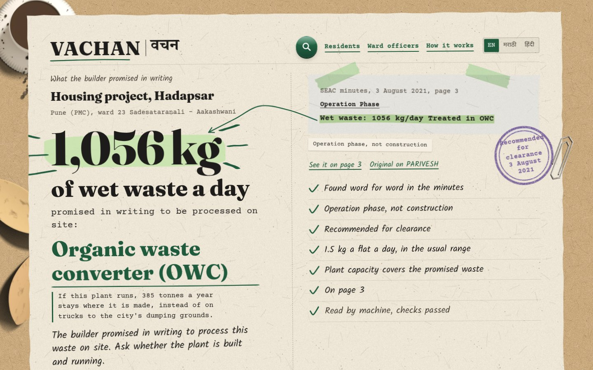
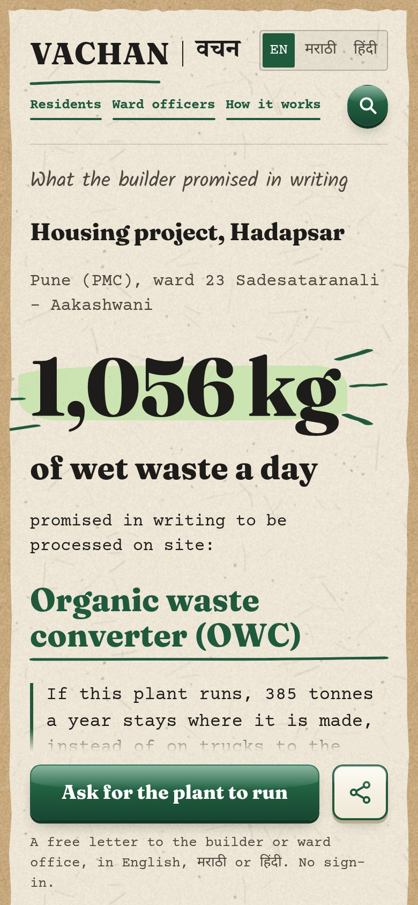
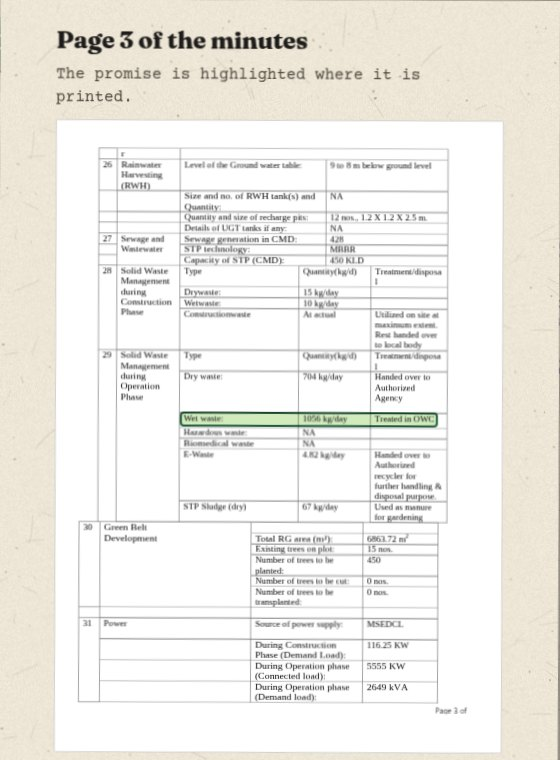
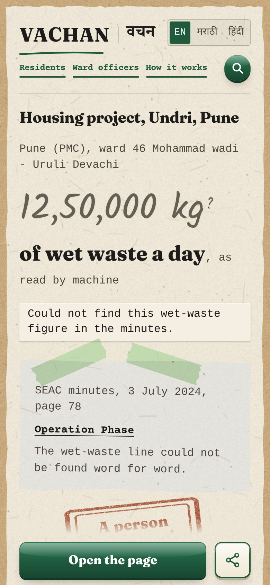
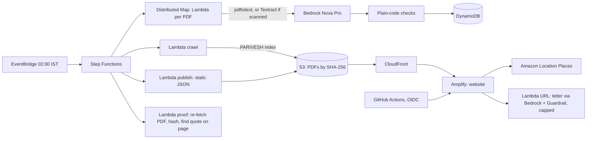

# VACHAN (वचन, "promise")
**Gets wet waste processed at source.** Large housing projects in Pune promised the government, in writing, to process their own wet waste on site. VACHAN reads those promises from public committee minutes with AWS, and shows any resident, buyer or ward officer the promise, the exact page it is written on, and a letter that asks for the plant to run.

**Video (2:59):** https://youtu.be/_HbZJ4fCaak · **Live:** https://main.d36c2lel7ok0qn.amplifyapp.com (no sign-in) · WeMakeDevs x AWS Environmental Hacks 2026, Waste & Energy track

[](https://youtu.be/_HbZJ4fCaak)

[0:00](https://youtu.be/_HbZJ4fCaak?t=0) The problem · [0:36](https://youtu.be/_HbZJ4fCaak?t=36) The builder's written promise · [1:00](https://youtu.be/_HbZJ4fCaak?t=60) Live demo · [1:19](https://youtu.be/_HbZJ4fCaak?t=79) Ask for the plant to run · [1:31](https://youtu.be/_HbZJ4fCaak?t=91) Ward officers and human review · [1:50](https://youtu.be/_HbZJ4fCaak?t=110) How it works on AWS · [2:22](https://youtu.be/_HbZJ4fCaak?t=142) Proof step · [2:40](https://youtu.be/_HbZJ4fCaak?t=160) 735 t a day across Pune



## Try it in 30 seconds
- [A promise near Seasons Mall, Hadapsar](https://main.d36c2lel7ok0qn.amplifyapp.com/p/sia-mh-mis-213829-2021): 1,056 kg of wet waste a day. Tap "See it on page 3" to open the government PDF with the line highlighted, then "Ask for the plant to run".
- [The same card in Marathi](https://main.d36c2lel7ok0qn.amplifyapp.com/p/sia-mh-mis-213829-2021?lang=mr). English, मराठी and हिंदी work on every screen and in the letter.
- [A record the machine is not sure about](https://main.d36c2lel7ok0qn.amplifyapp.com/p/sia-mh-infra2-46702): the model read 12,50,000 kg a day. Plain code could not find that figure in the minutes, so the card says a person must check it and offers no letter.
- [A ward officer's check-first list, PCMC ward 52](https://main.d36c2lel7ok0qn.amplifyapp.com/officer?ward=52): the largest written promises first, ready to print.

<p>



</p>

## The problem
- Pune (PMC) says housing societies and malls send about 300 t of wet waste a day to its plants, and wants that cut ([The Bridge Chronicle, 26 Aug 2026](https://www.thebridgechronicle.com/pune/punes-wet-waste-crisis-deepens-as-processing-capacity-falls-short-agn97)). In Nov 2025 it said 400–500 society plants "may be non-operational" ([Pune Pulse](https://www.mypunepulse.com/?p=178649)).
- Pimpri-Chinchwad (PCMC) generates about 1,500 t of waste a day and processes about 700. In June 2026 it told large housing societies to process their own wet waste or face fines ([Punekar News](https://www.punekarnews.in/pcmcs-major-decision-wet-waste-from-large-housing-societies-will-not-be-collected-from-july-1/)).
- To get environmental clearance, every large project told the State Expert Appraisal Committee (SEAC) how much wet waste it would make and how it would process it on site. Those promises sit in more than a thousand public PDFs that nobody reads.

## Who uses it, and what changes
| Person | Decision | What VACHAN gives them |
|---|---|---|
| Resident or housing federation | "Our society got a notice. What did our builder promise?" | The promise, kg a day, the PDF page, and a letter to the builder or ward office |
| Flat buyer or renter | "What am I signing up for?" | The written promise and one plain question to ask the builder |
| PCMC ward officer | "Whom do I check first this week?" | A list ranked by promised wet waste, never a verdict, plus a review queue |

## Proof numbers (run of 11 Oct 2026, 02:00 IST)
- **1,027** SEAC minutes PDFs read; **1,214** Pune project sites (PMC + PCMC).
- **735.6 t of wet waste a day** promised in writing (PMC 421.8, PCMC 313.7), counting only the **783** projects the committee recommended and that passed every check. **776** of those promise on-site processing.
- **829 of 829** published quotes re-checked against the live government PDF after the run, and each one located on its page.
- **385** records wait for a person to check them. The site says so on each one.
- The full backfill read 1,024 PDFs in 43 minutes with 4 parallel workers. 15 files failed inside the 10 % failure budget, and the run finished.
- The whole event used about **$10** of AWS, almost all of it Bedrock.

Every number here comes from [`stats.json`](https://d18hjofgs77fd1.cloudfront.net/data/stats.json), which each run publishes and CI checks on every push.

## How we used AWS
| Service | Job | Why this service | In the video |
|---|---|---|---|
| Amazon EventBridge | Starts the pipeline every night at 02:00 IST | New minutes arrive weekly | [1:52](https://youtu.be/_HbZJ4fCaak?t=112) |
| AWS Step Functions (Distributed Map) | Reads about 1,000 PDFs in parallel with retries and a failure budget | Scale, plus a run graph we can show | [1:54](https://youtu.be/_HbZJ4fCaak?t=114), [2:02](https://youtu.be/_HbZJ4fCaak?t=122) |
| AWS Lambda (container image) | Crawl PARIVESH, read each PDF (`pdftotext`), split it into agenda items, publish, prove, draft letters | One image, five small handlers | [1:55](https://youtu.be/_HbZJ4fCaak?t=115), [2:23](https://youtu.be/_HbZJ4fCaak?t=143) |
| Amazon S3 + Amazon CloudFront | Mirror of every source PDF (named by SHA-256) and the JSON the website reads | PARIVESH has broken TLS and partly fails outside India; judges must still open the page | [1:59](https://youtu.be/_HbZJ4fCaak?t=119), [2:22](https://youtu.be/_HbZJ4fCaak?t=142) |
| Amazon Textract | Reads minutes that are photographs of paper, where `pdftotext` finds no text | Without it, those meetings drop out silently | [2:08](https://youtu.be/_HbZJ4fCaak?t=128) |
| Amazon Bedrock (Amazon Nova Pro) | Reads one project at a time into a fixed schema; drafts the letter | Telling operation-phase waste from construction-phase waste needs reading, not regex | [2:10](https://youtu.be/_HbZJ4fCaak?t=130), [1:24](https://youtu.be/_HbZJ4fCaak?t=84) |
| Amazon Bedrock Guardrails | Stops any letter draft that uses one of 17 accusing words or phrases | A promise is not proof; a public letter tool must never accuse | [1:46](https://youtu.be/_HbZJ4fCaak?t=106) |
| Amazon DynamoDB | One row per proposal per minutes PDF | Simple key writes from parallel workers | [2:19](https://youtu.be/_HbZJ4fCaak?t=139) |
| Amazon Location Service (Places) | Address search for "promises near me" | Residents know their address, not survey numbers | [1:00](https://youtu.be/_HbZJ4fCaak?t=60), [2:34](https://youtu.be/_HbZJ4fCaak?t=154) |
| AWS Amplify Hosting | Hosts the website | A live link on an AWS domain | [2:32](https://youtu.be/_HbZJ4fCaak?t=152) |
| AWS CDK (CloudFormation) + IAM | All of the above as one stack; GitHub Actions deploys over OIDC with no stored AWS keys | Repeatable setup, no secrets in the repo | [2:36](https://youtu.be/_HbZJ4fCaak?t=156) |
| AWS Budgets + IAM | Alerts at $30, $48 and $60; at $50 an automatic deny policy stops Bedrock, Textract and new runs | A public, sign-in-free app must not run up a bill | not shown |

**The model only reads. Plain code decides.** After Bedrock returns a record, deterministic checks run:
- the figure must appear word for word on a "Wet waste" line;
- it must be the operation-phase figure, never the smaller construction-phase one;
- wet waste per flat must be 0.5 to 3 kg;
- the stated plant capacity must cover the promised waste;
- the committee decision must be readable.

Code, not the model, picks the quoted line and the page. Any failed check puts the record in review, and the card shows the reason.

## Architecture


## What it does when unsure
- A record that fails a check is shown in pencil with a rust stamp, "A person must check this", and the reason, word for word. It has no letter button, so no letter quotes an unchecked number.
- The Bedrock Guardrail stops any draft with an accusing word. The card and its page still stand.
- The letter Lambda is capped per day and runs two at a time.
- If a PDF cannot be read, the run skips it and continues (10 % failure budget). If Bedrock throttles, the worker retries with adaptive backoff. If PARIVESH is down, the crawl retries.

## Run it yourself
Needs: AWS account (ap-south-1), Node 22+, Docker, Python 3.12, `uv`.
```bash
# 1. Infrastructure and pipeline (CDK builds the Lambda image with Docker)
cd infra && npm install && npx cdk bootstrap && npx cdk deploy
# 2. First full run: start the state machine with {"all": true} (CdkOutput PipelineArn)
aws stepfunctions start-execution --state-machine-arn <PipelineArn> --input '{"all": true}'
# 3. Website: copy web/.env.example to web/.env and fill it from the CDK outputs, then
cd ../web && npm install && npm run dev        # local
./deploy.sh                                     # manual deploy to Amplify Hosting
# Tests
cd ../pipeline && uvx --with boto3 pytest -q
```
On every push, GitHub Actions runs the pipeline tests (38, including a table of real minutes lines for the status rules), the web type check and build, and a check of the published data. A push to `main` then deploys to Amplify.

All code in this repo was written during the event (8–11 Oct 2026). Before kickoff we only checked that the minutes were public.

## What is not built
- We do not know whether a plant runs today. We show what was promised in writing.
- Minutes before 2019 have no public index, and buildings below the clearance size are not in these minutes.
- 12 of the 1,027 minutes are scans. Textract reads them, but our agenda splitter does not yet recognise the scanned layout, so their projects are not in the totals.
- One damaged PDF (meeting 47956) is skipped.
- No hand-labelled accuracy figure yet. The status rules are tested against real lines from the minutes.

## What's next
- Sit with a PCMC or PMC ward officer to test the check-first order, and record what each inspection finds next to the promise.
- Hand-label about 40 records to publish a field-by-field accuracy figure.
- The crawler already reads every Maharashtra SEAC minutes PDF. Adding another city needs its ward map.

## Who did what
VACHAN has three parts: what to build, how it looks, and how it runs. Each of us owned one.

- **Dushyant Singh** ([@devvedub07](https://github.com/devvedub07)): **the problem and the look.** Chose the problem we took on. Studied the reference sites, wrote the design spec and the screen-by-screen concepts (the recycled-paper sheet on a desk, the highlighted quote, the compost pot), and chose the concept images the site is built from. Tested the live site on phones and laptops and reported every break.
- **Shreya Bableshwar** ([@shreyab09](https://github.com/shreyab09)): **the product and its outcome.** Defined what VACHAN must do for each person and what should change afterwards: a letter that asks for the plant to run, and a check-first list for the ward. Her review of our plan changed the product in two places. We never say a society "must" run a plant, because the 2026 rules allow certificates instead. And the pipeline flags any plant whose stated capacity is below the promised waste.
- **Siddhant Vishnu** ([@SidTheKid-dotcom](https://github.com/SidTheKid-dotcom)): **the build.** The AWS stack and the pipeline, the website, CI and deployment, and the video, with Claude Code as a coding partner. He lives in Hadapsar, next to the Seasons Mall in the demo.

## What we learned
- **A promise is not proof.** The minutes show what a builder promised in writing, not whether a plant was built or runs. We say "promised in writing" and "check first", never that anyone failed.
- **The hard part is one line.** Each project lists wet waste twice: during construction and after people move in. Only the second is the promise. A regex cannot tell them apart reliably, so Bedrock reads the block and plain code checks that the quoted line, the number and the page are really there.
- **Measure before you claim.** A first sample of 25 PDFs suggested 40 % were scanned images. The full corpus had 12 scans in 1,027. Our first total (over 350 t a day for PCMC alone) also fell once we dropped deferred proposals and counted each site once.
- **Data helps only when someone can act on it.** A total of 735 tonnes changes nothing. One building's promise, its page and a ready letter can.
- **Government sources fail, so keep a copy.** PARIVESH has broken TLS and outages. Mirroring every PDF on S3 and CloudFront is what lets anyone open the exact page.
- **Showing doubt builds trust.** 385 records say "A person must check this" with the reason. That turned out to be a feature, not an embarrassment.
- **People arrive from WhatsApp on a phone.** The number, the method and the page have to lead; everything else can wait.

## Our feedback on AWS
- **Amazon Bedrock model access:** Anthropic models needed a use-case form on our new account, so we used Amazon Nova Pro. On a 25-item sample it matched our plain-code figure on 23 of 24 items. A clearer note at sign-up about which models need a form would have saved us time at kickoff.
- **Bedrock Guardrails:** the prompt-attack filter read our own instructions as an injection and refused every letter draft. Guarding only the model's output fixed it. A worked example that separates the system prompt from user input would help.
- **Nova Pro request quota:** 50 requests a minute shaped the whole run; we capped the Distributed Map at 4 parallel workers. Seeing that limit next to the model in the console, before the first throttle, would help.
- **Step Functions Distributed Map:** retries and a failure budget let a run over about 1,000 PDFs finish when a few were damaged, and the run graph is the clearest way to show the pipeline to someone else.
- **GitHub Actions to Amplify over OIDC:** no stored keys is the right default, but getting the role's trust condition to match the token's subject claim took a debug step that printed the claims. An example for the GitHub subject format would have saved that.
- **AWS Budgets:** alerts were easy. Making spend automatically stop Bedrock, Textract and new runs at $50 needed a budget action plus a deny policy; a ready-made "stop these services" option would suit hackathons and public demos.

## AI tools used
- **Claude Code:** coding partner for the pipeline, infrastructure, website and the video's animated scenes.
- **ChatGPT and Codex image generation:** screen concepts only. Not shipped, except the link-preview image.
- **Amazon Bedrock (Nova Pro):** reads the minutes and drafts the letters.
- **faster-whisper** (open source): word timings, to sync the captions and animations to the narration.

## Credits and licences
- Code: MIT (see `LICENSE`). Data licences: see `NOTICE`.
- Minutes: PARIVESH, Ministry of Environment, Forest and Climate Change, Government of India (public documents).
- Ward boundaries: DataMeet Municipal Spatial Data, CC BY-SA 2.5 IN (PMC 2022 wards also MIT via answerquest/pune-2022-wards).
- Libraries: PDF.js (Apache-2.0), React and React Router (MIT). Poppler (GPL) runs as a command-line tool inside the Lambda image.
- News in the video, credited on screen: The Bridge Chronicle (photo and the 300 t figure), Free Press Journal (PCMC figures), The Indian Express (the Moshi collapse), Punekar News and Maha eNews (the PCMC notice and fines).
- Video: narrated by Siddhant in his own voice. The music bed and sound effects are synthesised in code for this video; no stock audio.
- Fonts: Fraunces, Courier Prime, Kalam, Noto Serif Devanagari (SIL Open Font License, via Google Fonts).
- Desk props: modelled and rendered in Blender (`props/`).
