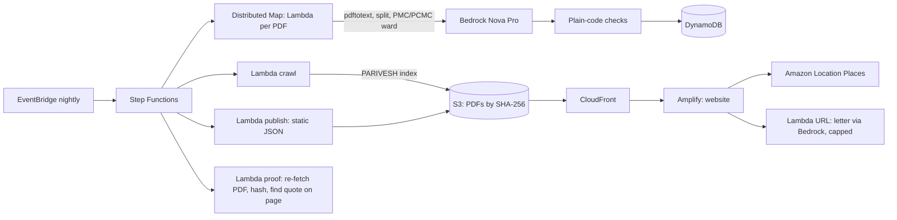

# VACHAN (वचन, "promise")
**Gets wet waste processed at source.** Large housing projects in Pune promised the government, in writing, to process their own wet waste on site. VACHAN reads those promises from public committee minutes with AWS, and shows any resident, buyer or ward officer the promise and the exact page it is written on.

**Live:** https://main.d36c2lel7ok0qn.amplifyapp.com · no sign-in · WeMakeDevs x AWS Environmental Hacks 2026, Waste & Energy track


## The problem
- Pimpri-Chinchwad generates about 1,500 t of waste a day and processes about 700. In June 2026 it told large housing societies to compost their own wet waste or face fines.
- Pune (PMC) says housing societies and malls send about 300 t of wet waste a day to its plants, and wants that cut.
- To get environmental clearance, every large project told the State Expert Appraisal Committee (SEAC) how much wet waste it would make and how it would process it on site. Those promises sit in more than a thousand public PDFs that nobody reads.

## Who uses it, and what changes
| Person | Decision | What VACHAN gives them |
|---|---|---|
| Resident or housing federation | "Our society got a notice. What did our builder promise?" | The promise, kg a day, the PDF page, and a letter to the builder or ward office |
| Flat buyer or renter | "What am I signing up for?" | The written promise and one plain question to ask the builder |
| PCMC ward officer | "Whom do I check first this week?" | A list ranked by promised wet waste, never a verdict, plus a review queue |

## Proof numbers (run of 10 Oct 2026, 04:20 UTC)
- **1,027** SEAC minutes PDFs read; **1,214** Pune project sites (PMC + PCMC).
- **735.6 t of wet waste a day** promised in writing (PMC 421.8, PCMC 313.7), counting only the **783** projects the committee recommended and that passed every check. **776** of those promise on-site processing.
- **829 of 829** published quotes re-checked against the live government PDF after the run.
- **385** records wait for a person to check them. The site says so on each one.

Every number here comes from [`stats.json`](https://d18hjofgs77fd1.cloudfront.net/data/stats.json), which the nightly run publishes and CI checks on every push.

## How we used AWS
| Service | Job | Why this service | In the video |
|---|---|---|---|
| Amazon EventBridge | Starts the pipeline every night at 02:00 IST | New minutes arrive weekly | Schedule rule |
| AWS Lambda (container image) | Crawl PARIVESH, read each PDF (`pdftotext`), split it into agenda items, publish, prove | One image, five small handlers | Function list |
| Amazon S3 + Amazon CloudFront | Mirror of every source PDF (by SHA-256) and the JSON the website reads | PARIVESH has broken TLS and partly fails outside India; judges must still open the page | "Open page 49" |
| AWS Step Functions (Distributed Map) | Reads about 1,000 PDFs in parallel with retries and a failure budget | Scale, plus a run graph we can show | The run graph |
| Amazon Bedrock (Amazon Nova Pro) | Reads one project at a time into a fixed schema; drafts the letter | Telling operation-phase waste from construction-phase waste needs reading, not regex | Letter drafting |
| Amazon DynamoDB | One row per proposal per minutes PDF | Simple key writes from parallel workers | |
| Amazon Location Service (Places) | Address search for "promises near me" | Residents know their address, not survey numbers | "Seasons Mall, Hadapsar" |
| AWS Amplify Hosting | Hosts the website | Live link on an AWS domain | The live URL |
| AWS Budgets + IAM | Alerts at $30, $48, $60; at $50 an automatic deny policy stops Bedrock and new runs | A public, sign-in-free app must not run up a bill | |
| AWS CDK (CloudFormation) | All of the above as one stack | Repeatable setup | `cdk deploy` |

**The model only reads. Plain code decides.** After Bedrock returns a record, deterministic checks run: the figure must appear word for word on a "Wet waste" line, it must be the operation-phase figure (never the smaller construction-phase one), wet waste per flat must be 0.5 to 3 kg, and the committee decision must be readable. Code, not the model, picks the quoted line and the page. Any failed check puts the record in review, and the card shows the reason.

## Architecture


## What it does when unsure
- A record that fails a check is shown in pencil with a rust stamp, "A person must check this", and the reason, word for word. It has no "Draft letter" button, so no letter quotes an unchecked number.
- A letter that contains an accusing word is not shown. The letter Lambda is capped per day and to two at a time.
- If a PDF cannot be read, the run skips it and continues (10 % failure budget). If Bedrock throttles, the worker retries with adaptive backoff.


## Run it yourself
Needs: AWS account (ap-south-1), Node 22+, Docker, Python 3.12, `uv`.
```bash
# 1. Infrastructure and pipeline (CDK builds the Lambda image with Docker)
cd infra && npm install && npx cdk bootstrap && npx cdk deploy
# 2. First full run: start the state machine with {"all": true} (CdkOutput PipelineArn)
aws stepfunctions start-execution --state-machine-arn <PipelineArn> --input '{"all": true}'
# 3. Website: copy web/.env.example to web/.env and fill it from the CDK outputs, then
cd ../web && npm install && npm run dev        # local
./deploy.sh                                     # Amplify Hosting
# Tests
cd ../pipeline && uvx --with boto3 pytest -q
```
Desk props are modelled in Blender: `blender -b -P props/render_props.py -- <out>` then `python props/to_webp.py <out> web/public/props`.

## What is not built
- We do not know whether a plant runs today. We show what was promised in writing.
- Minutes before 2019 have no public index, and buildings below the clearance size are not in these minutes.
- One damaged PDF (meeting 47956) is skipped; scanned minutes are not yet sent to OCR.

## AI tools used
Claude Code (coding partner), ChatGPT image generation (screen concepts only, not shipped except the link-preview image), Amazon Bedrock Nova Pro (reading the minutes, drafting letters).

## Credits and licences
- Minutes: PARIVESH, Ministry of Environment, Forest and Climate Change, Government of India (public documents).
- Ward boundaries: DataMeet Municipal Spatial Data, CC BY-SA 2.5 IN (PMC 2022 wards also MIT via answerquest/pune-2022-wards).
- Fonts: Fraunces, Courier Prime, Kalam, Noto Serif Devanagari (SIL Open Font License, via Google Fonts).
- Desk props: modelled and rendered in Blender by the team.
